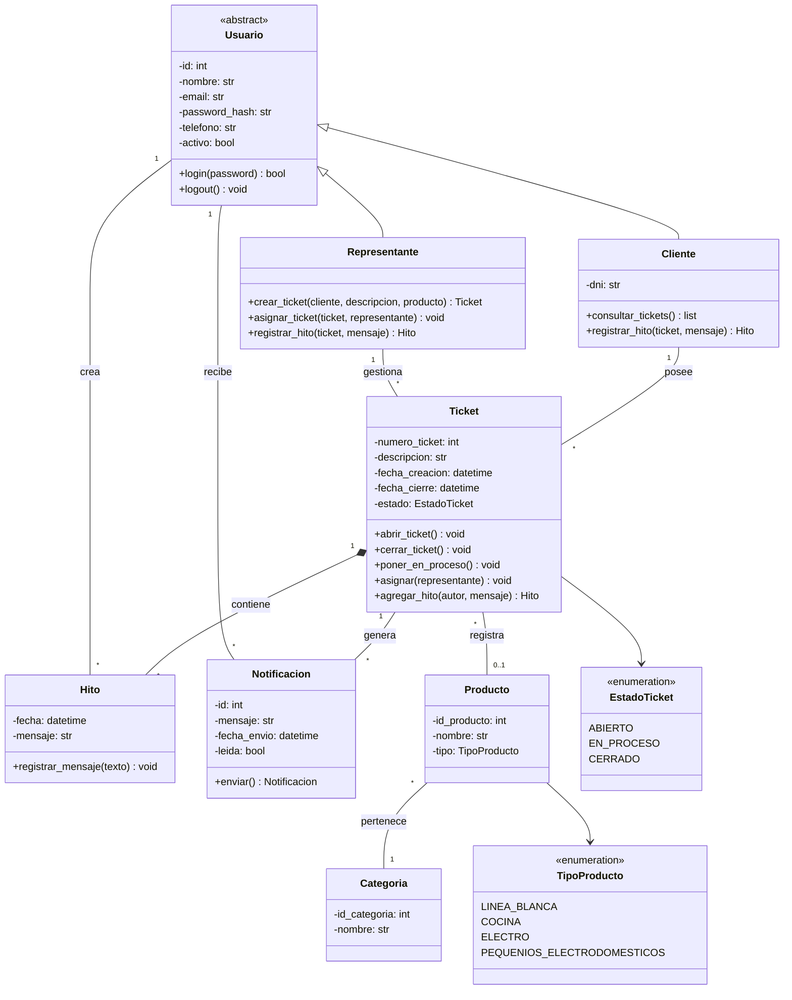

# Arquitectura · Sistema de Ticketing TECNOSOL Mar del Plata

## 1. Vista general

La aplicación está organizada en **capas**. Cada capa solo conoce a la de abajo:

```
┌──────────────────────────────────────────────────────────────┐
│  Navegador (HTML + CSS + JS)                                  │
└───────────────▲──────────────────────────────────────────────┘
                │ HTTP
┌───────────────┴──────────────────────────────────────────────┐
│  app/web/        Capa web (Flask)                             │
│  Rutas, formularios, login, permisos, CSRF, plantillas Jinja  │
└───────────────▲──────────────────────────────────────────────┘
                │ llama a
┌───────────────┴──────────────────────────────────────────────┐
│  app/services/   Lógica de negocio                            │
│  Validaciones, transacciones, permisos, notificaciones        │
└───────────────▲──────────────────────────────────────────────┘
                │ usa
┌───────────────┴──────────────────────────────────────────────┐
│  app/models/     Dominio (clases del diagrama) + SQLAlchemy   │
│  Reglas propias de cada clase: workflow, validaciones         │
└───────────────▲──────────────────────────────────────────────┘
                │ ORM
┌───────────────┴──────────────────────────────────────────────┐
│  SQLite          instancia/tecnosol.db                     │
└──────────────────────────────────────────────────────────────┘
```

**¿Por qué así?**

- Las reglas viven en los **modelos** y en los **servicios**, no en las pantallas. Así se pueden **testear sin navegador**, que es la base del TDD.
- La capa web es delgada: recibe el formulario, llama al servicio y muestra el resultado o el error.
- Si mañana se reemplaza la web por una API o una app de escritorio, los modelos y servicios no cambian.

## 2. Diagrama de clases implementado

Corresponde a la **versión 2** del diagrama del TP:



## 3. Modelo de datos (tablas)

| Tabla | Clase(s) | Columnas principales |
|---|---|---|
| `usuarios` | Usuario, Cliente, Representante | `id`, `nombre`, `email` (UNIQUE), `password_hash`, `telefono`, `activo`, `tipo`, `dni` (UNIQUE) |
| `tickets` | Ticket | `numero_ticket`, `descripcion`, `fecha_creacion`, `fecha_cierre`, `estado`, `cliente_id` → usuarios, `representante_id` → usuarios, `producto_id` → productos |
| `hitos` | Hito | `id`, `fecha`, `mensaje`, `ticket_id` → tickets, `autor_id` → usuarios |
| `notificaciones` | Notificacion | `id`, `mensaje`, `fecha_envio`, `leida`, `destinatario_id` → usuarios, `ticket_id` → tickets |
| `productos` | Producto | `id_producto`, `nombre`, `tipo`, `categoria_id` → categorias |
| `categorias` | Categoria | `id_categoria`, `nombre` (UNIQUE) |

Las tablas se crean automáticamente al abrir la aplicación (`Base.metadata.create_all`).

## 4. Decisiones de diseño

| Decisión | Motivo |
|---|---|
| **Herencia de tabla única** para Usuario / Cliente / Representante | Respeta la herencia del diagrama con una sola tabla. La columna `tipo` indica la subclase. `Usuario` se declara *abstracta* (`polymorphic_abstract`), así que no se pueden crear usuarios sin rol. |
| **Ticket → Producto como "muchos a uno"** | El diagrama indica `1 — 1`, pero un mismo modelo de producto (por ejemplo "Heladera No Frost 360L") puede tener muchos tickets de distintos clientes. Por eso cada ticket referencia a un producto y el producto lista sus tickets. |
| **`Producto.categoria` como clase `Categoria`** | La versión 2 tiene a la vez el atributo `categoria: string` y la clase `Categoria`. Se eligió la clase para evitar categorías duplicadas o mal escritas. |
| **`abrirTicket()` = reabrir** | La creación del ticket ya lo deja ABIERTO (CU001, paso 5), así que `abrir_ticket()` se usa para **reabrir** un ticket cerrado, como describe el enunciado. |
| **Representante asignado al crear** | CU001 dice que el representante registra el ticket. Queda asignado como responsable y la notificación siempre tiene un "otro actor" a quien avisar. |
| **El cliente también crea tickets** | El cliente abre tickets **solo a su nombre**: el servicio ignora cualquier `cliente_id` que llegue del formulario. No puede registrar otros clientes; la gestión de usuarios sigue siendo exclusiva de los representantes. |
| **Cola de tickets (backlog)** (`TicketService.tomar`, `tomar_siguiente`, `contar_cola`) | Cuando el ticket lo abre un cliente, **no se asigna a nadie**: entra en la cola (sin representante, sin cerrar) y se avisa a todos los representantes activos. Un representante lo **toma** (queda asignado a él y pasa a *En proceso*), ya sea uno en particular o **el siguiente**, que es el que más tiempo espera (orden de llegada, FIFO). Si un representante responde un ticket en cola, también lo toma. Un ticket que ya tomó otro no se puede volver a tomar (se reasigna con "Asignar representante"). |
| **Notificaciones internas** | El enunciado habla del "sistema de mensajería del ticket": las notificaciones quedan almacenadas y se ven en la bandeja (campanita). No se envían emails reales. |
| **Baja lógica de usuarios** | Borrar un usuario rompería el historial de tickets e hitos. Se marca `activo = False`. |
| **Transacciones en servicios** (`@transaccional`) | Cada operación se confirma completa o se deshace completa. Cubre la excepción *"Error al guardar"* de los casos de uso. |
| **Validaciones en el modelo** | `Ticket`, `Hito` y `Usuario` se validan al construirse: un ticket sin descripción o un hito vacío **no pueden existir**, ni siquiera en memoria. |
| **Seguridad** | Contraseñas con hash (scrypt, vía Werkzeug), sesión firmada con una clave secreta propia de cada instalación, token CSRF en cada formulario, redirecciones solo internas y control de permisos por rol en cada ruta y servicio. |

## 5. Flujo de una petición (ejemplo: CU003 Registrar hito)

```
Navegador ── POST /tickets/7/hitos ──▶ web/tickets.py::registrar_hito
                                          │ (login_requerido, CSRF verificado)
                                          ▼
                              TicketService.registrar_hito(7, usuario, mensaje)
                                          │ obtener(7, usuario)  → verifica permiso
                                          │ usuario.registrar_hito(ticket, mensaje)
                                          │     └─ Ticket.agregar_hito → valida, crea Hito,
                                          │                              ABIERTO→EN_PROCESO si responde rep.
                                          │ NotificacionService.notificar(otro actor)
                                          │ commit  (o rollback si algo falla)
                                          ▼
Navegador ◀── redirect /tickets/7#historial + mensaje "Hito registrado"
```

## 6. Interfaz

- Diseño propio en `app/static/css/estilos.css`, sin frameworks.
- Paleta: **rojo `#FC0000`** solo como acento (botón principal, estado *Abierto* y avisos), **negro `#1A1A1A`** y **blanco**, más grises de apoyo. Tipografías **Michroma** (títulos) y **Roboto** (texto). Sin degradados ni efectos.
- **Responsive**: en celulares el menú lateral se pliega y las tablas ocultan columnas secundarias.
- Íconos de línea en SVG (`app/web/iconos.py`).
- JavaScript liviano (`app/static/js/app.js`): menú móvil, filas clickeables, confirmaciones, filtro de clientes y contador de caracteres. La aplicación funciona también sin JavaScript.
